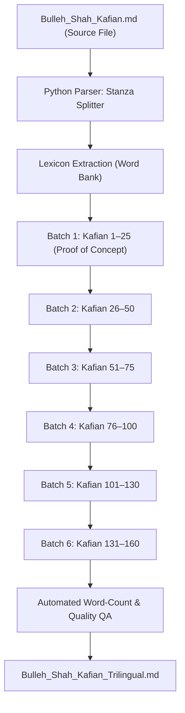

# Baba Bulleh Shah: Kafian — Trilingual Word-by-Word & Poetic Translation Plan

---

## 1. Project Objective & Scope

Create an authentic, academic, and devotional trilingual study edition for all **160 Kafian** of Baba Bulleh Shah (approximately **5,130 lines** and **26,000+ words**):

1. **Original Text**: Classical Punjabi/Lahndi in Devanagari script.
2. **Word-by-Word Gloss**:
   - Meaning of each word in **Hindi**.
   - Meaning of each word in **English**.
3. **Poetic Translations (Metered & Rhymed Verse)**:
   - Stanza-by-stanza **Hindi poetic translation** with authentic line breaks.
   - Stanza-by-stanza **English poetic translation** with authentic line breaks.

---

## 2. Format & Layout Specification (Layered Block Model)

Each Kafi is formatted cleanly according to standard GitHub Flavored Markdown (GFM):

````markdown
## 15. बंसी काहन अचरज बजाई

### मूल काफ़िया (Original Poem)

बंसी वालिआ चाका रांझा, तेरा सुर है सभ नाल सांझा,  
तेरियां मौजां साडा मांझा, साडी सुर तैं आप मिलाई ।  
बंसी काहन अचरज बजाई ।  

---

### पद-वार अर्थ (Word-by-Word Gloss)

**बंसी वालिआ चाका रांझा, तेरा सुर है सभ नाल सांझा,**  
**हिन्दी:** बंसी (बांसुरी) वालिआ (वाले) चाका (ग्वाले/सेवक) रांझा (रांझा), तेरा (तुम्हारा) सुर (स्वर) है (है) सभ (सबके) नाल (साथ) सांझा (साझा/समान),  
**English:** bansi (flute) walia (bearing/player) chaaka (cowherd/servant) ranjha (Ranjha), tera (your) sur (melody/tune) hai (is) sabh (all) naal (with) saanjha (shared/common),  

**तेरियां मौजां साडा मांझा, साडी सुर तैं आप मिलाई ।**  
**हिन्दी:** तेरियां (तुम्हारी) मौजां (आनंद/तरंगें) साडा (हमारा) मांझा (मांझा/किनारा), साडी (हमारी) सुर (स्वर) तैं (तुमने) आप (स्वयं) मिलाई (मिला दी है) ।  
**English:** teriyan (your) maujan (waves/bliss) saada (our) maanjha (midstream/flow), saadi (our) sur (tune) tain (you yourself) aap (spontaneously) milaai (harmonized/united) .  

**बंसी काहन अचरज बजाई ।**  
**हिन्दी:** बंसी (बांसुरी) काहन (कान्हा/कृष्ण) अचरज (अद्भुत/विस्मयकारी) बजाई (बजाई है) ।  
**English:** bansi (flute) kaahan (Krishna/Beloved) achraj (wondrous/mystic) bajaai (has played) .  

### हिन्दी काव्यात्मक भावार्थ (Hindi Poetic Meaning)

हे कान्हा! हे मुरलीधर रांझा,  
तेरी बांसुरी का सुर सबके नाल है सांझा!  

तेरी मौजों में जीवन का किनारा मिल गया,  
तेरी धुन में हमारा सुर अपने-आप मिल गया!  

### English Poetic Translation

O cowherd Ranjha, divine flutist dear,  
Your sweet melody rings for all to hear!  

In the flow of your ecstasy our lives align,  
As you attuned our soul to your tune divine!
````

---

## 3. Linguistic Architecture & Dual-Lexicon Caching Engine

Across the 160 Kafian, approximately **70% of the vocabulary is recurring** (*Ishq, Ranjha, Maahi, Vich, Naal, Chhadd, Vehde, Vall, Saiyo*, etc.).

### Structured Vocabulary Database (`data/punjabi_sufi_lexicon.json`):
```json
{
  "बंसी": {
    "hi": "बांसुरी",
    "en": "flute",
    "sufi_context": "Divine melody / celestial call"
  },
  "सभ": {
    "hi": "सब / सभी",
    "en": "all / everyone"
  },
  "सांझा": {
    "hi": "साझा / समान",
    "en": "shared / common to all"
  },
  "अचरज": {
    "hi": "अद्भुत / विस्मयकारी",
    "en": "wondrous / mystical"
  },
  "चाक": {
    "hi": "ग्वाला / विनम्र सेवक",
    "en": "cowherd / humble servant"
  }
}
```

**Benefits:**
- **Consistency**: The translation of recurring mystical motifs remains stable across all poems.
- **Speed & Efficiency**: Approximately ~18,000 of the 26,000 words map directly from the lexicon cache, allowing focused human/AI attention on context-dependent nuances.

---

## 4. Batch Processing Pipeline (Pause & Resume Capable)

To ensure manageable execution, the workload is organized into 6 modular batches:



### Batch Details:
1. **Pilot Prototype (Kafian 1 & 2)**: Verification of layout, punctuation, and verse rhythm.
2. **Batch 1 (Kafian 1–25)**: Famous opening Kafian (*Aa Mil Yaar, Tere Ishq Nachaya, Bulla Ki Jaana*, etc.).
3. **Batch 2 (Kafian 26–50)**: Completing Part 1.
4. **Batch 3 (Kafian 51–75)**: Part 2 (First half).
5. **Batch 4 (Kafian 76–100)**: Part 2 (Second half).
6. **Batch 5 (Kafian 101–130)**: Part 3 (First half).
7. **Batch 6 (Kafian 131–160)**: Part 3 (Second half & completion).

---

## 5. Automated Quality Assurance

After each batch is generated, automated integrity scripts verify:
1. **Word-Count Parity**: `Original line words == Hindi gloss tokens == English gloss tokens`.
2. **Punctuation Alignment**: Exact match and placement of `।`, `,`, and `?`.
3. **Zero Missing Words**: Confirming every single source word has an assigned gloss.
4. **Sufi Context Integrity**: Balancing the literal and spiritual layers of meaning.

---

## 6. Project Directory & File Layout

All files are strictly maintained within the local workspace folder:

```
c:\my-code\Bulleh-Shah\
├── Bulleh_Shah_Kafian.md              # Original clean text (preserved, untouched)
├── Bulleh_Shah_Kafian_Trilingual.md   # Final assembled trilingual edition
├── TRANSLATION_PLAN.md               # Layout and translation philosophy (this file)
├── IMPLEMENTATION_PLAN.md             # Technical execution and checkpoint guide
├── README.md                          # Repository overview and links
├── data/                              # Local data and cache
│   ├── checkpoint.json                # Progress tracker for pause/resume
│   ├── raw_kafian.json                # Structured raw text of all 160 poems
│   ├── punjabi_sufi_lexicon.json      # Trilingual glossary cache
│   └── kafian/                        # Individual JSON units (kafi_001.json .. kafi_160.json)
└── scripts/                           # Local Python automation scripts
    ├── 01_extract_raw.py              # Raw parser
    ├── 02_process_kafi.py             # Resumable processing engine
    ├── 03_assemble_edition.py         # Markdown compiler
    └── 04_validate_integrity.py       # Quality assurance validator
```
